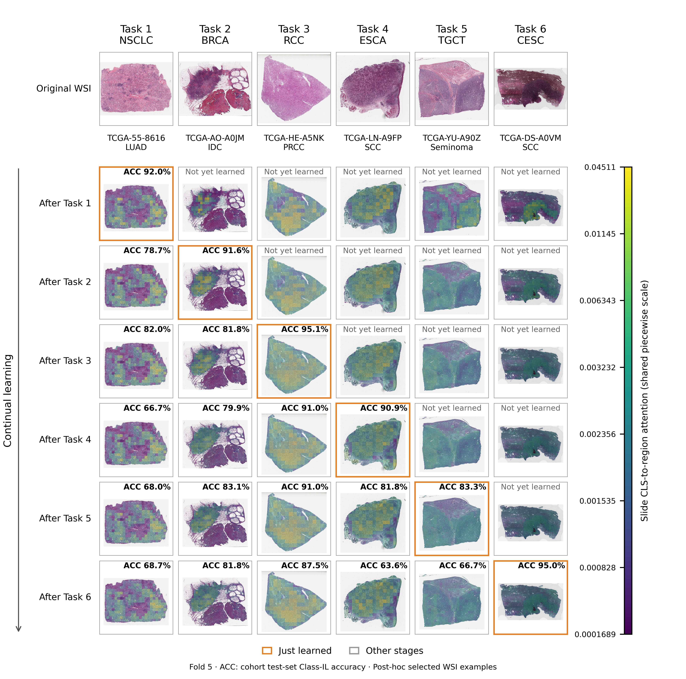
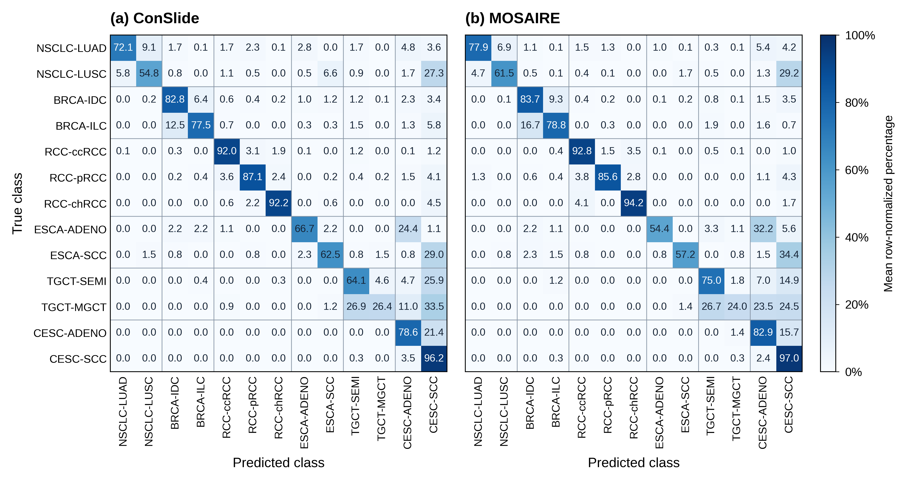
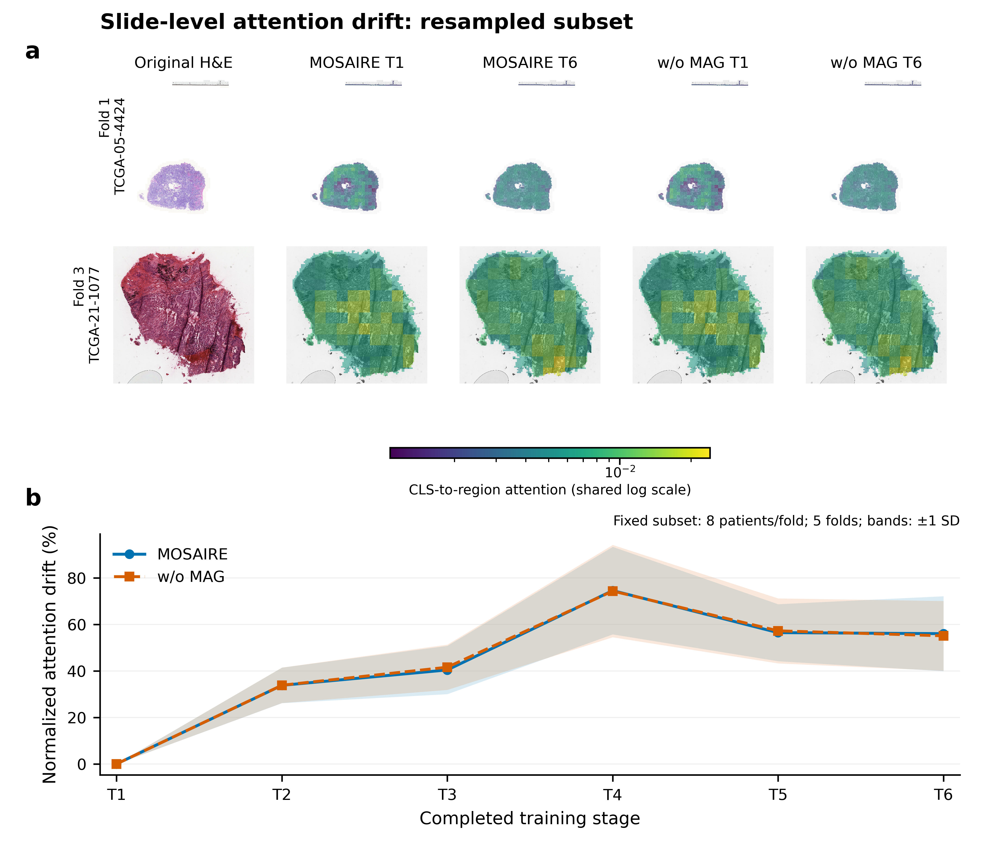

# MOSAIRE

Official main figures for **MOSAIRE**.

This lightweight repository contains the paper figures only. The paper title,
author list, publication link, and citation will be added after they are
finalized.

## Main figures

### Continual attention evolution

### ConSlide and MOSAIRE confusion matrices

### Slide-level attention drift

PDF versions are provided in the same directory for publication-quality use.

## Citation

Citation information will be added when the paper metadata is public.

## License

This repository is released under the [MIT License](LICENSE).
